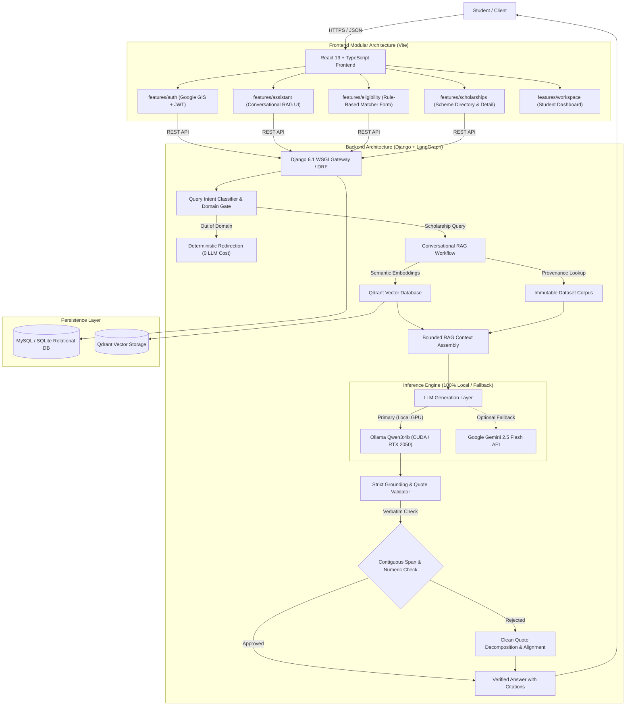

# Scholarship Navigator

[](https://python.org)
[](https://www.typescriptlang.org)
[](https://react.dev)
[](https://djangoproject.com)
[](https://qdrant.tech)
[](https://ollama.ai)
[](https://mysql.com)
[](tests/)

An enterprise-grade, privacy-first scholarship intelligence platform powered by **Local Retrieval-Augmented Generation (RAG)**, deterministic grounding validation, and an automated multi-criteria eligibility matching engine. 

Scholarship Navigator provides students with clear, conversational guidance backed by verbatim contiguous source evidence, real-time scheme comparison, automated document check-lists, and authenticated candidate workspace management.

---

## Architecture Overview



---

## Key Capabilities

- **100% Local & GPU-Accelerated Stack**:
  - Powered by local `qwen3:4b` on Ollama with full NVIDIA CUDA GPU offloading (benchmarked at ~30 tokens/second).
  - Offloaded sentence embeddings via `embeddinggemma:latest` running on CPU with bounded `10m` memory caching, reducing vector search latency to **~180–380 ms**.
  - Zero requirement for external proprietary APIs or cloud credits.

- **Strict Verbatim Grounding Guardrails**:
  - Deterministic Pydantic validation ensures every single claim is backed by an exact, character-for-character contiguous quote from the official scholarship documentation.
  - Automatic quote sanitizer resolves compound quotes, line breaks, and punctuation mismatches.
  - Verifies all numeric figures (income limits, study years, award values) against source evidence to completely eliminate LLM hallucinations.

- **High-Performance Vector Search with Qdrant**:
  - Migrated from legacy local file indices to **Qdrant Vector Database**, supporting both embedded local storage and distributed server/Docker deployments.
  - Section-aware metadata filtering (`eligibility`, `benefits`, `documents_required`, `important_notes`).

- **Deterministic Eligibility Matching Engine**:
  - Dedicated rule engine evaluates student attributes (domicile state, category, annual family income, course level, percentage, disability status, single girl child status) against official criteria rules without relying on LLM guesswork.

- **Enterprise Student Authentication**:
  - Dual-mode authentication supporting native credentials (email/password with secure session tokens) and Google Identity Services (GIS) One-Tap OAuth.
  - Gated student workspaces keeping search history and sessions isolated.

---

## Repository Layout

```text
scholarship-rag-assistant/
├── backend/                        # Django REST API & RAG Core
│   ├── api/                        # API endpoints (assistant, auth, health, views)
│   ├── apps/                       # Django application modules (navigator models, migrations)
│   │   └── navigator/management/  # Management commands (ingest_scholarships, seed)
│   ├── config/                     # Project configuration (settings, urls, wsgi)
│   ├── core/                       # Core engine services
│   │   ├── agent/                  # LangGraph workflow, execution graph & tools
│   │   ├── rag/                    # Qdrant vector store, embeddings, query classifier
│   │   ├── corpus.py               # Immutable dataset loader & provenance verifier
│   │   ├── llm.py                  # QwenProvider (Ollama) & strict grounding validator
│   │   ├── memory.py               # Conversation session manager
│   │   └── quantities.py           # Quantity normalization for evidence verification
│   └── manage.py                   # Django CLI entrypoint
├── frontend/                       # React 19 + TypeScript Client (Vite)
│   └── src/
│       ├── components/             # Reusable UI primitives (Source card, Facts, Badges)
│       ├── features/               # Feature-based domain modules
│       │   ├── assistant/          # Conversational RAG chat & message history
│       │   ├── auth/               # AuthGateway, SignIn, and session management
│       │   ├── eligibility/        # Student eligibility matching form & rules
│       │   ├── scholarships/       # Scheme directory, search & detail views
│       │   └── workspace/          # Student workspace shell & overview dashboard
│       ├── services/               # HTTP client (api.ts) & hash router (navigation.ts)
│       ├── types/                  # Shared TypeScript interfaces
│       ├── styles/                 # Application design system & global CSS
│       ├── App.tsx                 # Root application router
│       └── main.tsx                # Client bootstrap
├── data/                           # Verified scholarship corpus & QA reports
├── evaluation/                     # RAGAS benchmarks, adapters & evaluation suites
├── deploy/                         # Nginx configurations & deployment manifests
├── docker-compose.yml              # Multi-container orchestration (Backend, Qdrant, MySQL)
├── Dockerfile                      # Production container image definition
├── pyproject.toml                  # Python build configuration & pytest options
├── requirements.txt                # Production Python dependencies
└── tests/                          # Backend test suite (43 unit & integration tests)
```

---

## Quickstart Guide

### Prerequisites

- **Python**: Version 3.10 to 3.12 (Python 3.12 recommended)
- **Node.js**: Version 20+ LTS
- **Ollama**: Installed and running ([Download Ollama](https://ollama.ai))
- **GPU (Optional but recommended)**: NVIDIA GPU with CUDA support for sub-second inference

---

### 1. Model Setup (Ollama)

Pull the generation model and embedding model:

```bash
ollama pull qwen3:4b
ollama pull embeddinggemma:latest
```

Ensure Ollama is running:
```bash
ollama serve
```

---

### 2. Environment Configuration

Copy the template environment file:

```bash
cp .env.example .env
```

Default configuration for the 100% local stack:
```dotenv
DJANGO_DEBUG=true
DB_ENGINE=mysql
MYSQL_DATABASE=scholarships
MYSQL_USER=scholarships
MYSQL_PASSWORD=your_password
MYSQL_HOST=127.0.0.1
MYSQL_PORT=3306

# Vector Database (leave empty for embedded local Qdrant storage)
QDRANT_URL=

# LLM Configuration (Local Qwen via Ollama)
LLM_PROVIDER=qwen
LLM_MODEL=qwen3:4b
OLLAMA_URL=http://127.0.0.1:11434
EMBEDDING_MODEL=embeddinggemma:latest

# Output & Token Limits
LLM_MAX_OUTPUT_TOKENS=750
LLM_TIMEOUT_SECONDS=60
LLM_GROUNDING_REVIEW=auto
```

*(Note: If MySQL is not running locally, setting `DB_ENGINE=sqlite` will automatically use a local SQLite database for zero-configuration development.)*

---

### 3. Backend Setup

```powershell
# Create and activate virtual environment
python -m venv .venv
.\.venv\Scripts\activate   # On Linux/macOS: source .venv/bin/activate

# Install dependencies
pip install -r requirements.txt

# Run migrations and ingest dataset into Qdrant
python backend/manage.py migrate
python backend/manage.py ingest_scholarships

# Start Django development server
python backend/manage.py runserver 127.0.0.1:8000
```

---

### 4. Frontend Setup

In a separate terminal:

```powershell
cd frontend

# Install dependencies
npm install

# Start Vite development server
npm run dev
```

Open [http://localhost:5173](http://localhost:5173) in your browser.  
Swagger API Documentation is available at [http://127.0.0.1:8000/api/docs](http://127.0.0.1:8000/api/docs).

---

## Docker Compose Deployment

To run the entire ecosystem (Django Backend + MySQL 8.0 + Qdrant Vector DB + Nginx) via Docker Compose:

```bash
docker-compose up -d --build
```

Services exposed:
- **Backend API**: `http://localhost:8000`
- **Qdrant Dashboard**: `http://localhost:6333/dashboard`
- **MySQL Server**: `localhost:3306`

---

## Core API Endpoints

| Endpoint | Method | Description |
| :--- | :---: | :--- |
| `/api/agent/query` | `POST` | Primary conversational RAG assistant endpoint with strict grounding. |
| `/api/scholarships/search` | `POST` | Semantic & keyword scholarship search with category filters. |
| `/api/scholarships/<id>` | `GET` | Full provenance details, benefits, eligibility, and documents for a scheme. |
| `/api/eligibility/check` | `POST` | Deterministic criteria evaluation engine for student profiles. |
| `/api/auth/register` | `POST` | Register a new candidate account. |
| `/api/auth/login` | `POST` | Authenticate with email/password and obtain a session token. |
| `/api/auth/google` | `POST` | Authenticate using Google One-Tap Identity Services. |
| `/api/auth/me` | `GET` | Retrieve the currently authenticated student profile. |
| `/health/ready` | `GET` | Health readiness check verifying relational DB and vector store indexes. |
| `/health/live` | `GET` | Liveness probe for container orchestrators. |

---

## Quality Assurance & Testing

### Backend Unit & Integration Tests

Run the complete 43-test suite covering LLM providers, grounding verification, Qdrant vector persistence, and conversational workflows:

```bash
pytest tests/test_llm.py tests/test_agent.py tests/test_rag.py -v
```

### Frontend Component & Integration Tests

Run Vitest component tests:

```bash
npm --prefix frontend test
```

### Production Build Verification

```bash
npm --prefix frontend run build
```

---

## Benchmarks & Performance Metrics

| Operation | Target Model / Engine | Latency |
| :--- | :--- | :---: |
| **Domain Classification** | Semantic Embedding Distance | `~120 ms` |
| **Vector Search** | Qdrant Vector Store + `embeddinggemma` | `~180–380 ms` |
| **Detailed Answer Generation** | `qwen3:4b` (100% GPU / RTX 2050) | `~12–18 s` (~30 tokens/sec) |
| **Grounding Verification** | Contiguous Verbatim Quote Matcher | `< 10 ms` |
| **Overall RAG Turn** | End-to-End Pipeline | **`~18–22 s`** |

---

## License

This project is licensed under the MIT License. See [LICENSE](LICENSE) for details.
