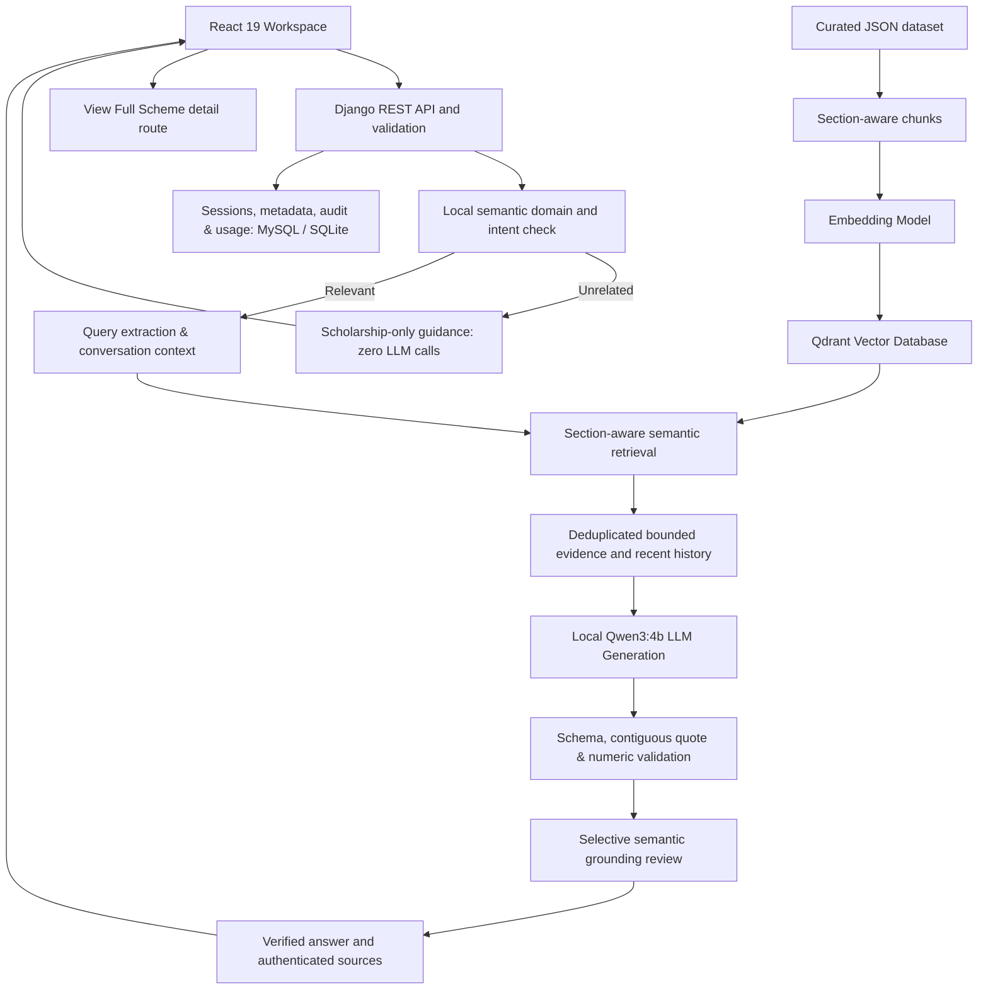

# Scholarship RAG Architecture

RAG serves as the deterministic factual engine: JSON -> embeddings / vector retrieval -> bounded context -> LLM -> verified answer & sources. Domain gates prevent off-topic generation, while verbatim quote validators and numeric checks eliminate hallucinations.
